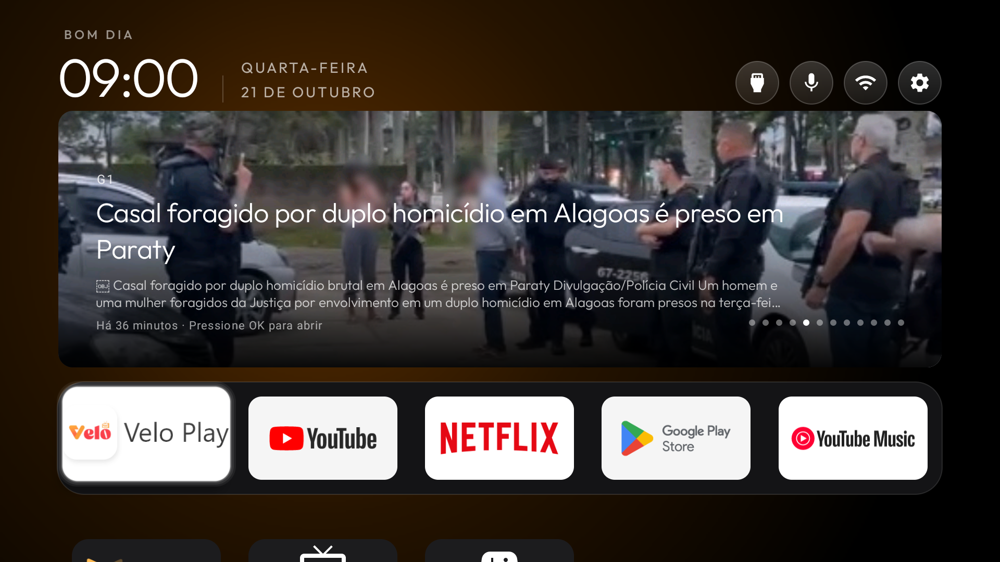
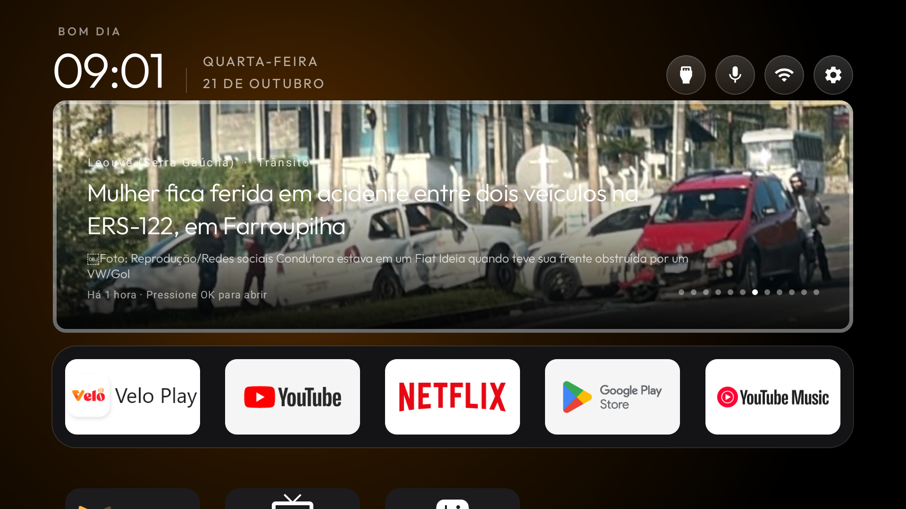
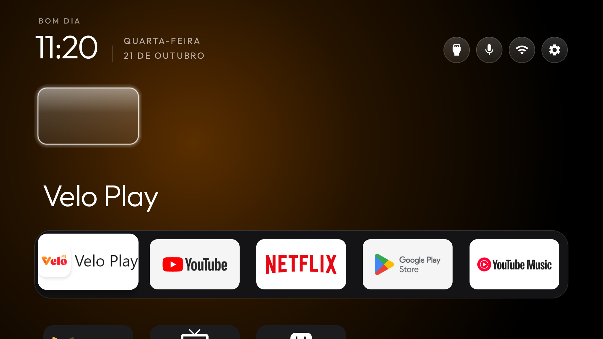
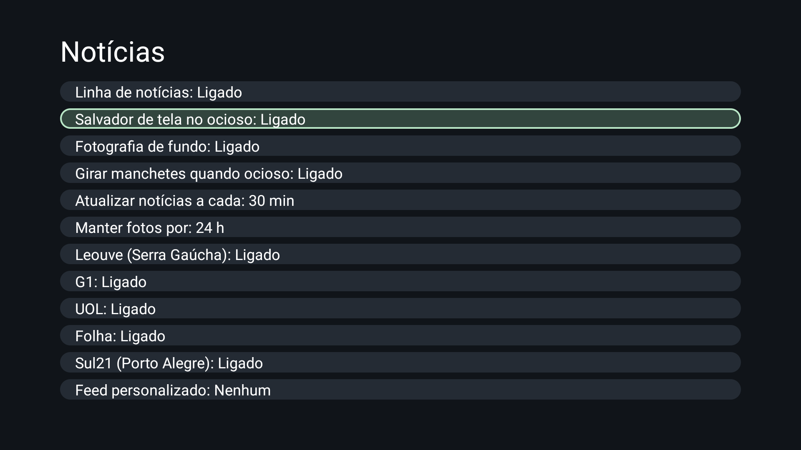
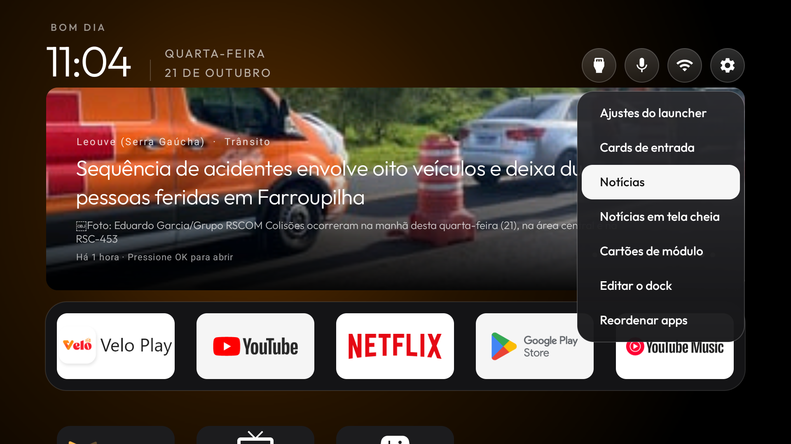

# RSS Cinematográfico — galeria de capturas

Capturas reais feitas em uma **Philco 4K (MediaTek, Android TV, density 320)** com o build
`2.5` (`versionCode 6`) desta branch, via `adb screencap`. Nenhuma imagem é maquete ou fixture:
cada print é a tela do aparelho no momento da captura. Quando um print serve só para mostrar um
estado de teste (e não o recurso em uso), isso está dito na legenda.

Data das capturas: 21/10/2026.

## A Home com a linha de notícias

### Carrossel com foto ampla (modo cinema)

O cabeçalho de sempre (saudação, relógio grande, data) fica intacto; abaixo dele, um único
carrossel com a manchete em foco: foto ao fundo, fonte, título, resumo e data. Apps e cards de
entrada dividem a mesma grade com as notícias — sem seção separada.

### Foco no carrossel

O carrossel participa da navegação normal: OK abre a notícia na fonte original.

### Rola junto com os apps

A rolagem vertical é conjunta: o bloco de notícias sobe junto com a grade de apps. Não há
fileira presa no topo nem salto de foco.

### Bloco subindo ao descer do topo

Aqui se vê também o pill "Entradas" com o rótulo ao lado no foco, e uma manchete sem foto
(Sul21): o carrossel se sustenta só com texto.

### Com a linha de notícias desligada (estado de teste)

Estado capturado com "Linha de notícias: **Desligado**" para provar que o recurso desliga de
verdade: sem carrossel, sem foto, sem busca de feed. O carrossel de volta assim que o
interruptor é religado (o cache mantido evita a tela vazia — correção feita nesta branch).

## Configurações de RSS

A tela "Notícias" (menu do launcher → Notícias): interruptor mestre, salvador de tela no
ocioso, foto de fundo, rotação no ocioso, intervalo de atualização (30 min), tempo de retenção
das fotos (24 h) e as cinco fontes ligadas (Leouve, G1, UOL, Folha, Sul21), além de feed
personalizado.

## Chegando até a tela de configurações

Pressionar e segurar o botão Configurações abre o menu do launcher; o item "Notícias" leva à
tela acima.

## Notas de captura

- Os prints foram tirados com o aparelho real, sem edição; o único processamento foi o recorte
  de nada — as imagens são o PNG completo do `screencap`.
- Nenhum dado privado aparece: sem contas, rede Wi-Fi com nome de rede aberto da fábrica,
  lista de apps padrão de fábrica + instalados para teste.
- O bug de encoding do feed da Folha (declara ISO-8859-1 e serve UTF-8) aparece como `` em
  alguns títulos nos prints capturados antes da correção — é comportamento conhecido e está
  registrado no relatório; G1/UOL/Sul21 saem corretos.
